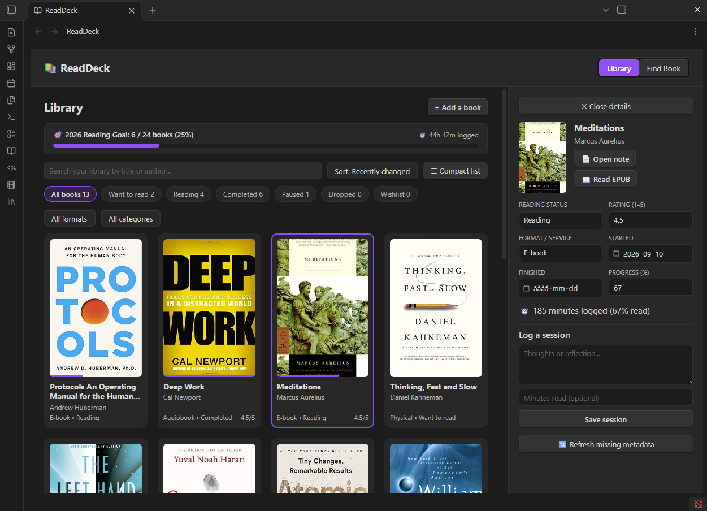
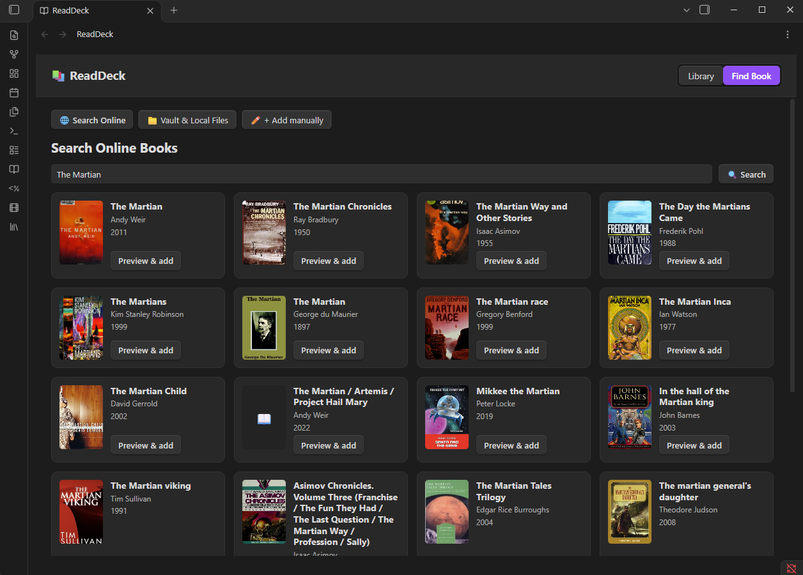
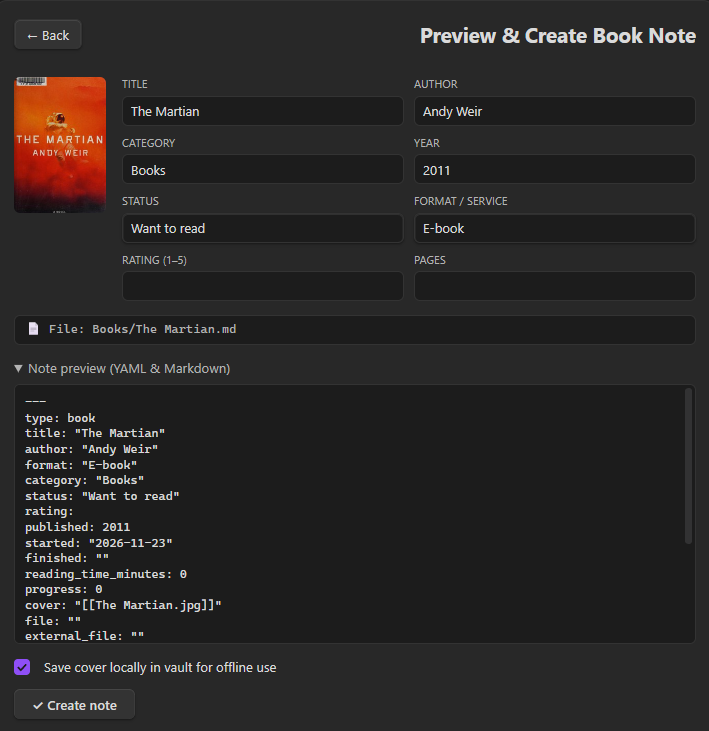
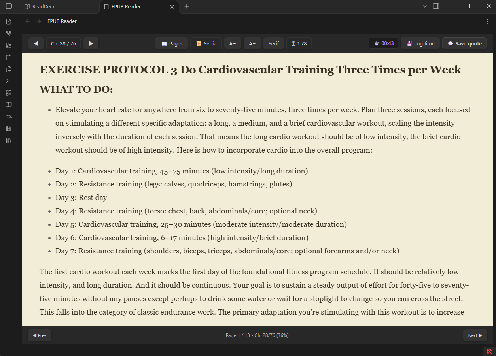
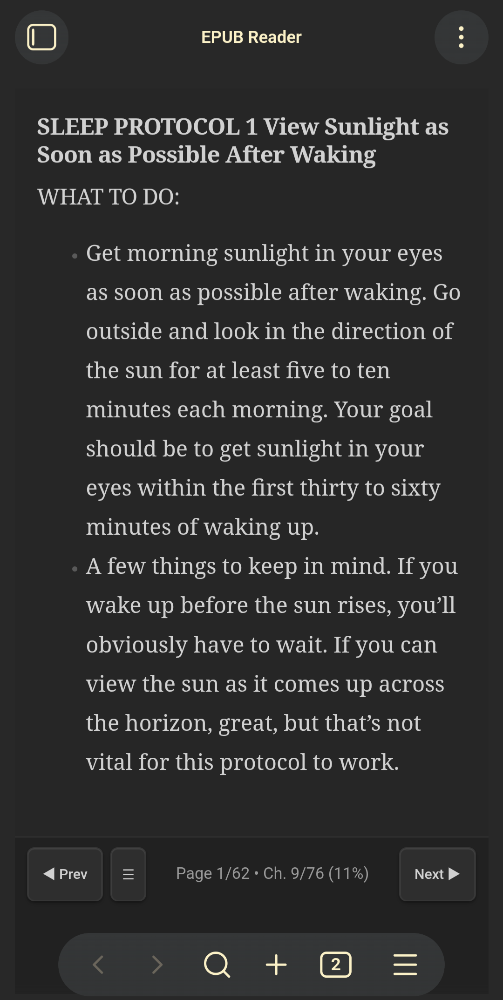
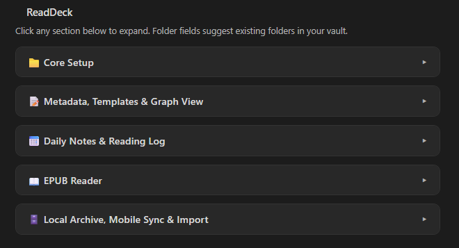

# ReadDeck

A local-first visual book library and built-in EPUB reader for Obsidian. Organize your reading list, download book covers offline, log reading sessions directly to your notes and Daily Notes, and read EPUBs in a paginated or scrolling reader with an integrated timer and quote capture.

## Features

- **Visual Library & Compact List:** Browse your book notes as a responsive cover grid or compact list, filter by status, format/service, or category, and sort by recently changed, title, author, or rating.
- **Preview Before Creating:** Inspect and edit title, author, status, format, rating, filename, and generated Markdown/YAML before creating a note.
- **Built-in Paginated & Scrolling EPUB Reader:**
  - Read vault-stored EPUBs directly inside Obsidian (no need to enable *Detect all file extensions*).
  - Switch between **Paginated (`Pages`)** mode (swipe, tap edges, or use arrow keys) and **Scrolling (`Scroll`)** mode.
  - **Distraction-Free Focus Mode:** Tap the center of the page (or toolbar toggle) to hide the top controls while reading.
  - **Automatic Bookmarking & Timer:** Remembers your exact chapter and page across sessions, tracks active reading time, and captures highlighted passages as `> [!quote]` callouts.
  - Customizable **Dark**, **Sepia**, and **Light** themes, font size, font family (Serif/Sans), column width, and line spacing.
- **Offline Covers & Full Offline Mode:** Download validated cover images (max 3 MiB) locally into your vault, or disable online lookups completely to work 100% offline.
- **Daily Note Mirroring:** Optionally mirror reading sessions to today's Daily Note (YAML properties for reading minutes/books and optional log lines under a custom heading), with automatic support for nested date folders (e.g., `YYYY/MM/`).
- **Annual Reading Goal:** Track completed books for the current year and total logged reading time.
- **Custom Structure:** Supports English or Swedish schemas out of the box, plus custom filename templates, custom statuses, custom formats/services, custom Markdown body templates, and JSON property remapping.
- **Safe Metadata Refresh & CSV Import:** Fill in missing covers, page counts, or publication years without overwriting personal ratings or notes, or import reading history from Goodreads / StoryGraph CSV exports.
- **Optional Desktop Archive Scan:** On desktop, optionally scan a local folder (such as a Calibre archive) for EPUB/PDF/MOBI files and sync individual files into your vault for mobile reading.

## Screenshots

### Search & Preview Before Creating
| Search Online, Vault & Manual Entry | Preview & Edit YAML Before Saving |
| :---: | :---: |
|  |  |

### Built-in EPUB Reader & Settings
| Paginated EPUB Reader (Desktop) | Distraction-Free Focus Mode (Mobile) |
| :---: | :---: |
|  |  |

### Collapsible Settings

## Installation

### Manual Installation
1. Download `main.js`, `manifest.json`, and `styles.css` from the latest [GitHub Release](../../releases).
2. Create a folder at `<your-vault>/.obsidian/plugins/readdeck/`.
3. Copy the three files into that folder.
4. Reload Obsidian and enable **ReadDeck** under **Settings -> Community plugins**.

## Privacy, Networking & Upstream Limits

ReadDeck is local-first and sends **no vault contents, personal notes, ratings, reading logs, or telemetry** to any external service. There is no background crawling, analytics, or advertising.

Online features are user-initiated only and can be turned off completely via **Settings -> ReadDeck -> Core Setup -> Online search & remote covers**.

| Destination | Purpose |
| --- | --- |
| `openlibrary.org` | User-initiated book searches and missing-metadata lookups |
| `covers.openlibrary.org` | Cover previews and optional local cover downloads into the vault |

- **Cover download protection:** Downloaded covers are verified against supported image signatures (JPEG, PNG, WebP, GIF) and capped at 3 MiB before saving.
- **Desktop vs. Mobile:** Core library management, online search, offline covers, CSV import, Daily Note mirroring, and vault-stored EPUB reading work on both desktop and mobile. Optional external-disk scanning and external app launching are strictly guarded behind `Platform.isDesktopApp` and are never invoked on mobile.

## License & Attribution

Released under the [MIT License](LICENSE).

ReadDeck is an independent community plugin and is not affiliated with Obsidian or Open Library. Book metadata and cover artwork belong to their respective rights holders.
